# Лабораторна робота №1

**Дисципліна:** Структура даних і алгоритми  
**Заклад освіти:** КПІ ім. Ігоря Сікорського, ФІОТ, кафедра обчислювальної техніки  
**Виконав:** Степанов А. О., студент групи ІО-62  
**Номер у списку групи:** 23  
**Перевірив:** Русінов В. В.  
**Київ — 2026**

## Завдання

Задано дійсне число `x`. Визначити значення заданої за варіантом кусково-неперервної функції `y(x)`, якщо воно існує, або вивести на екран повідомлення про неіснування функції для заданого `x`.

Розв'язати задачу двома способами (написати дві програми):

1. У програмі дозволяється використовувати тільки одиничні операції порівняння (`=`, `<>`, `<`, `<=`, `>`, `>=`) і не дозволяється використовувати булеві (логічні) операції (`not`, `and`, `or` тощо).
2. У програмі необхідно обов'язково використати булеві (логічні) операції (`not`, `and`, `or` тощо); використання булевих операцій не повинно бути надлишковим.

## Варіант 23


## Спосіб 1 — без логічних операторів

### Блок-схема

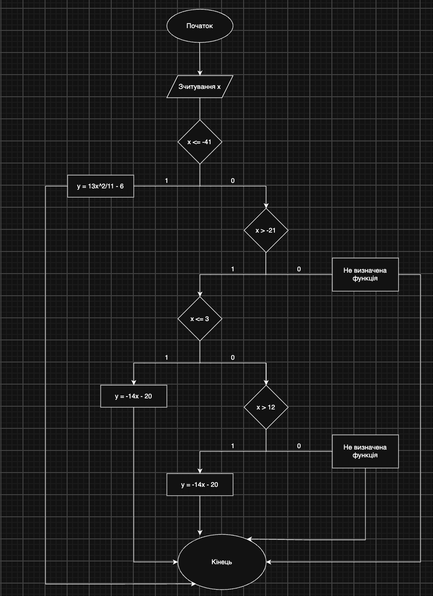

### Код програми

Файл: [`Lab1_variant23_method1.c`](Lab1_variant23_method1.c)

```c
#include <stdio.h>

int main(void) {
    double x, y;

    printf("Enter x: ");

    if (scanf("%lf", &x) != 1) {
        printf("Invalid input\n");
    }
    else if (x <= -41) {
        y = 13 * x * x / 11 - 6;
        printf("Y = %f\n", y);
    }
    else if (x > -21) {
        if (x <= 3) {
            y = -14 * x - 20;
            printf("Y = %f\n", y);
        }
        else if (x > 12) {
            y = -14 * x - 20;
            printf("Y = %f\n", y);
        }
        else {
            printf("Function undefined\n");
        }
    }
    else {
        printf("Function undefined\n");
    }

    return 0;
}
```

### Скріншоти виконання програми

**`x = -50`**

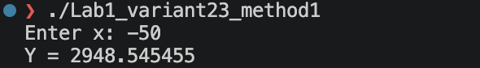

**`x = -36`**

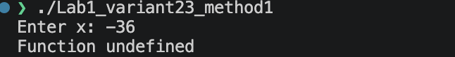

**`x = -17`**

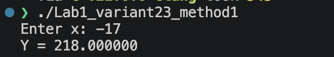

**`x = 9`**

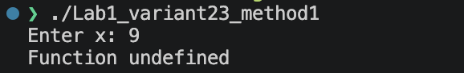

**`x = 67`**

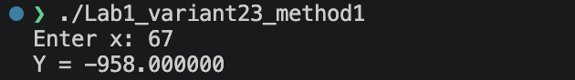

## Спосіб 2 — з логічними операторами

### Блок-схема

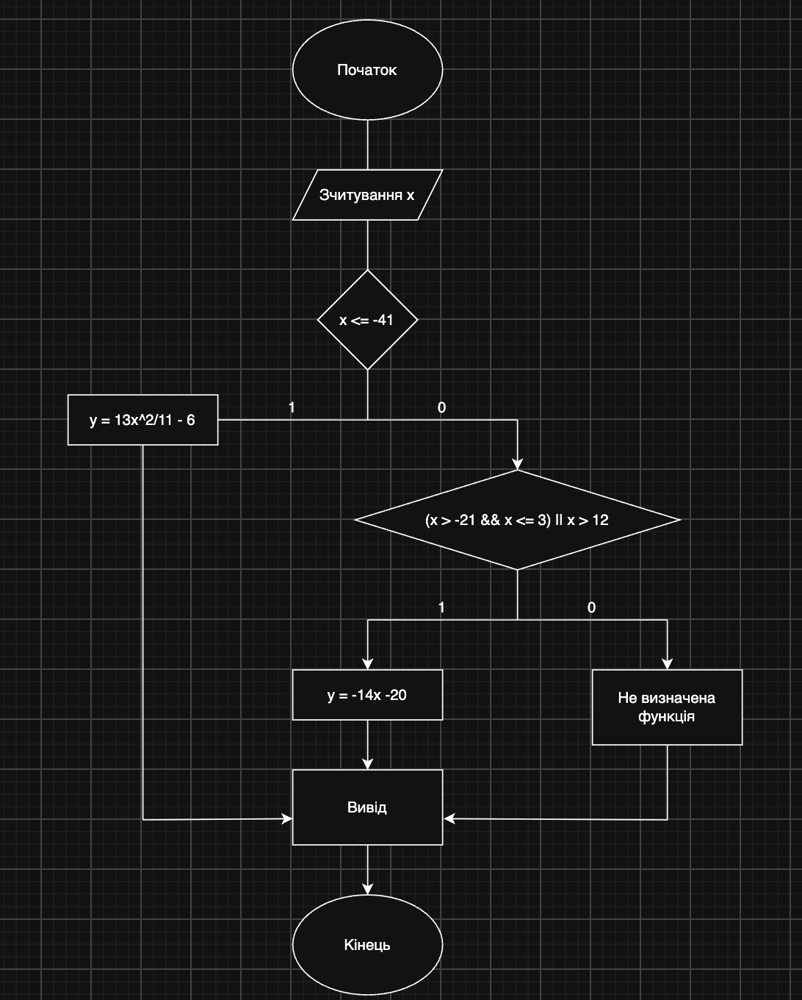

### Код програми

Файл: [`Lab1_variant23_method2.c`](Lab1_variant23_method2.c)

```c
#include <stdio.h>

int main(void) {
    double x, y;

    printf("Enter x: ");

    if (scanf("%lf", &x) != 1) {
        printf("Invalid input\n");
    }
    else if (x <= -41) {
        y = 13 * x * x / 11 - 6;
        printf("Y = %f\n", y);
    }
    else if ((x > -21 && x <= 3) || x > 12) {
        y = -14 * x - 20;
        printf("Y = %f\n", y);
    }
    else {
        printf("Function undefined\n");
    }

    return 0;
}
```

### Скріншоти виконання програми

**`x = -52`**

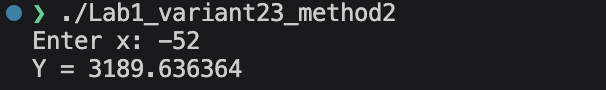

**`x = -24`**

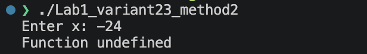

**`x = 3`**

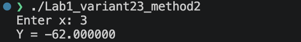

**`x = 11`**


**`x = 42`**

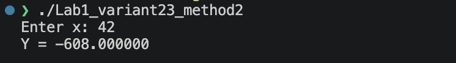

## Висновок

Під час виконання лабораторної роботи Я навчився створювати програми мовою C з використанням умовних операторів `if`, `else if` та `else`. Закріпив навички роботи з операторами порівняння та логічними операціями `&&` і `||`, а також навчився обчислювати значення функцій залежно від заданих інтервалів.
