# Лабораторна робота №2

**Міністерство освіти і науки України**  
**Заклад освіти:** Національний технічний університет України «Київський політехнічний інститут ім. І. Сікорського»  
**Факультет:** Факультет інформатики та обчислювальної техніки  
**Кафедра:** Кафедра обчислювальної техніки  
**Дисципліна:** Структура даних і алгоритми  
**Виконав:** Степанов А. О., студент групи ІО-62  
**Номер у списку групи:** 23  
**Перевірив:** Русінов В. В.  
**Київ — 2026**

## Мета

Засвоєння теоретичного матеріалу та набуття практичних навичок використання різних циклічних керуючих конструкцій, вкладених циклів, методу динамічного програмування та обчислення кількості операцій алгоритмів.

## Завдання

1. Задане натуральне число `n`. Обчислити значення заданої за варіантом формули (ряду або добутку, що наближено обчислює значення певної функції у заданій точці; точність наближення залежить від кількості ітерацій `n`).
2. Для розв'язання задачі написати **дві програми**:

   1. Перша програма обчислює формулу за допомогою **вкладених циклів**.
   2. Друга програма обчислює ту саму формулу за допомогою **одного циклу** з використанням **методу динамічного програмування** (тобто накопичуючи черговий доданок/множник на основі попереднього, без повторного обчислення статечних, факторіальних і подібних виразів «з нуля» на кожній ітерації).

3. Виконати розрахунок кількості операцій для кожного з алгоритмів за методикою, викладеною на лекції, додавши до неї підрахунок кількості викликів стандартних функцій.
4. Програма має правильно розв'язувати задачу при будь-якому заданому `n`, для якого результат обчислення коректно представляється типом `double`.
5. Результат виводити у форматі із **сімома знаками після коми**.

## Варіант 23

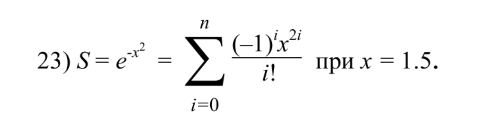

## Програма 1

### Алгоритм

1. Ввести `n`.
2. Для кожної `i` від `0` до `n` установити `t = 1`, внутрішнім циклом від `1` до `i` обчислити доданок та додати його до суми. Вивести суму і лічильник.

### Код програми

Файл: [`Lab2_variant23_code1.c`](Lab2_variant23_code1.c)

```c
#include <stdio.h>

int main(void)
{
    int n, i, j;
    double x = 1.5, s = 0, t;
    long long count = 0;

    printf("Введіть n: ");
    scanf("%d", &n);

    count += 2;
    count += 2;
    for (i = 0; i <= n; i++) {
        t = 1;
        count++;
        count += 2;
        for (j = 1; j <= i; j++) {
            t = -t * x * x / j;
            count += 5;
            count += 3;
        }
        s = s + t;
        count += 2;
        count += 3;
    }

    printf("S = %.7f\n", s);
    printf("Кількість операцій: %lld\n", count);
    return 0;
}
```

### Скріншоти виконання програми

**`n = 2`**

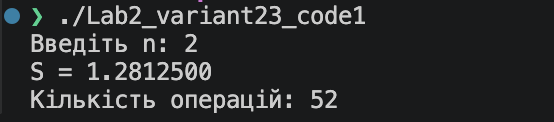

**`n = 3`**

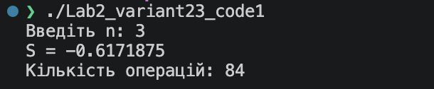

**`n = 20`**

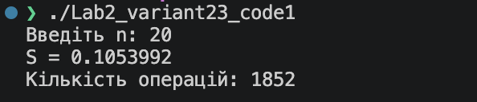

## Програма 2

### Алгоритм

1. Ввести `n`.
2. Узяти `s = t = 1`. Для `i` від `1` до `n` обчислити новий доданок із попереднього та додати його до суми. Вивести суму і лічильник.

### Код програми

Файл: [`Lab2_variant23_code2.c`](Lab2_variant23_code2.c)

```c
#include <stdio.h>

int main(void)
{
    int n, i;
    double x = 1.5, s = 1, t = 1;
    long long count = 0;

    printf("Введіть n: ");
    scanf("%d", &n);

    count += 3;
    count += 2;
    for (i = 1; i <= n; i++) {
        t = -t * x * x / i;
        count += 5;
        s = s + t;
        count += 2;
        count += 3;
    }

    printf("S = %.7f\n", s);
    printf("Кількість операцій: %lld\n", count);
    return 0;
}
```

### Скріншоти виконання програми

**`n = 2`**

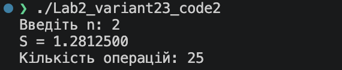

**`n = 3`**

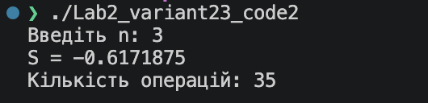

**`n = 20`**

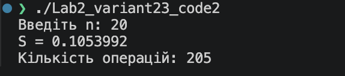

## Підрахунок операцій

Рахується обчислювальна частина після введення `n`. За одну операцію прийнято арифметичну дію, унарний мінус, присвоєння, порівняння, інкремент або перехід циклу. Введення, виведення та зміни самого лічильника не враховуються. Викликів функцій бібліотеки `math` немає.

У першій програмі початкові дії дають 4 операції; кожна зовнішня ітерація - 8 операцій і ще 8 на кожну внутрішню ітерацію. У другій програмі початкових операцій 5, а в кожній ітерації - 1.

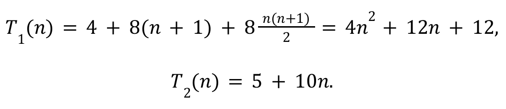

| n | T₁(n) | T₂(n) | Sₙ |
| ---: | ---: | ---: | ---: |
| 1 | 28 | 15 | -1.2500000 |
| 2 | 52 | 25 | 1.2812500 |
| 3 | 84 | 35 | -0.6171875 |
| 10 | 532 | 105 | 0.1055567 |
| 20 | 1852 | 205 | 0.1053992 |
| 30 | 3972 | 305 | 0.1053992 |
| 50 | 10612 | 505 | 0.1053992 |
| 100 | 41212 | 1005 | 0.1053992 |

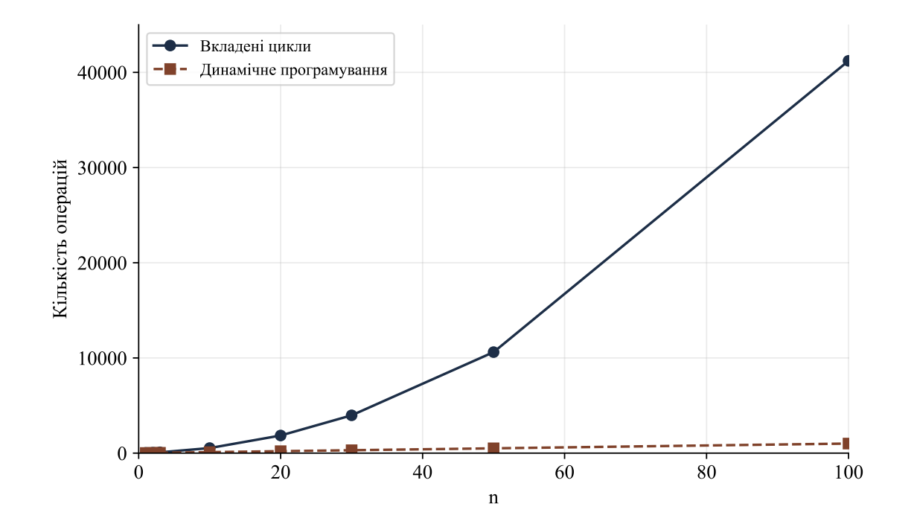

## Похибка та перевірка обчислень

Графік показує похибку усічення ряду до округлення результату для виведення:

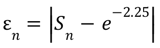

Обидва способи обчислюють ту саму часткову суму.

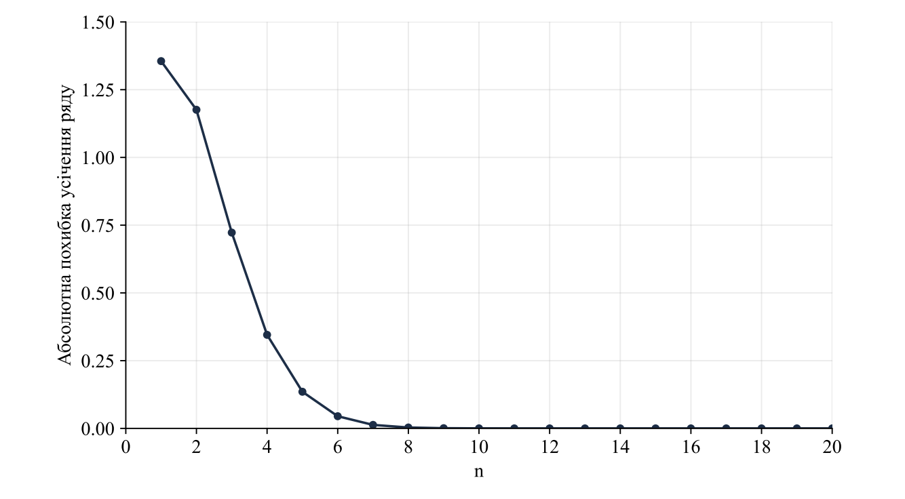

### Покрокова перевірка значень зі скріншотів

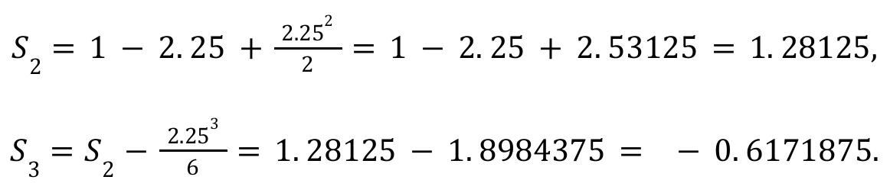

Отже, очікуваний вивід: `1.2812500` для `n = 2` та `-0.6171875` для `n = 3`. Для `n = 20` обидві програми виводять `0.1053992`.

## Висновки

Обидва способи дають однакову суму із заданою точністю виведення. Вкладені цикли потребують `O(n²)` операцій, один цикл - `O(n)`. При `n = 100` лічильники дорівнюють `41212` і `1005`. Зі збільшенням `n` похибка усічення ряду прямує до нуля; надалі точність обмежується округленням типу `double`.
