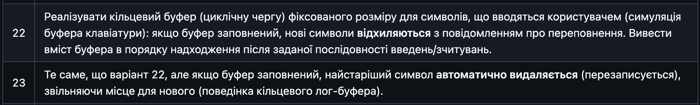
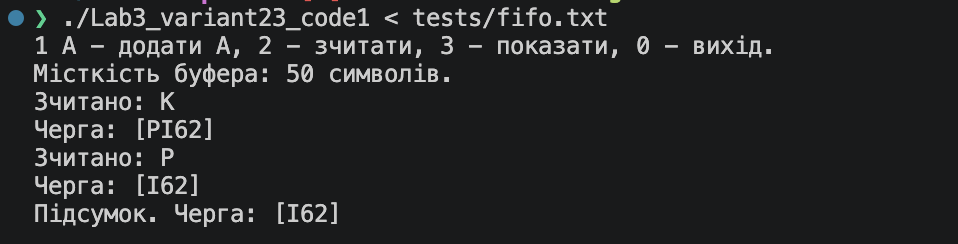
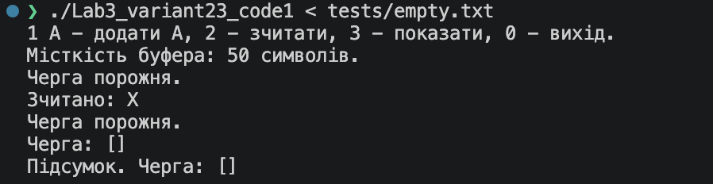
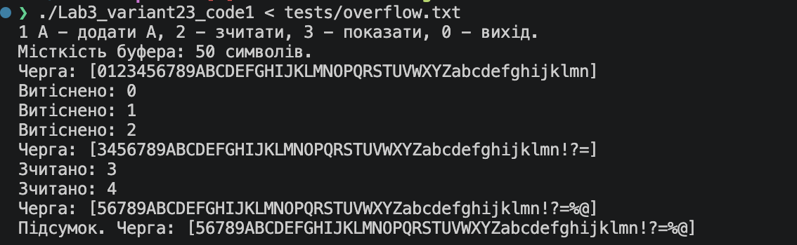
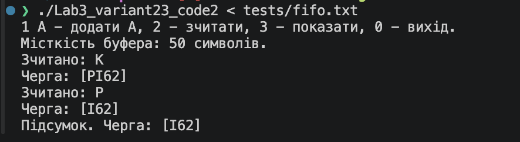
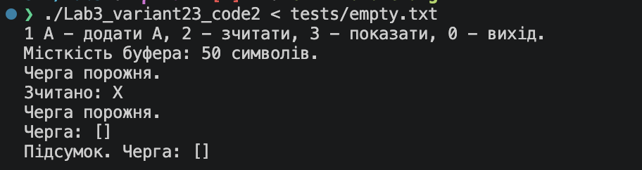
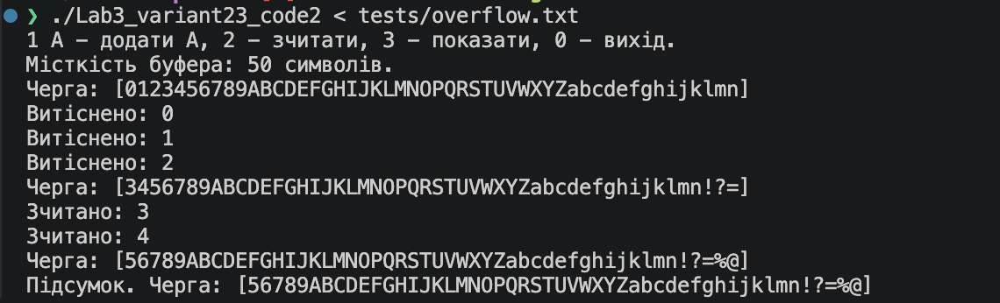

# Лабораторна робота №3

**Міністерство освіти і науки України**  
**Заклад освіти:** Національний технічний університет України «Київський політехнічний інститут ім. І. Сікорського»  
**Факультет:** Факультет інформатики та обчислювальної техніки  
**Кафедра:** Кафедра обчислювальної техніки  
**Дисципліна:** Структура даних і алгоритми  
**Виконав:** Степанов А. О., студент групи ІО-62  
**Номер у списку групи:** 23  
**Перевірив:** Русінов В. В.  
**Київ — 2026**

## Мета

Засвоєння теоретичного матеріалу та набуття практичних навичок реалізації й застосування абстрактних структур даних **стек** (LIFO — «останнім прийшов, першим вийшов») та **черга** (FIFO — «першим прийшов, першим вийшов»), а також порівняння двох способів їхньої реалізації — на основі масиву фіксованого розміру та на основі однозв'язного списку.

## Завдання

1. Кожен варіант завдання визначає прикладну задачу (наприклад, перевірку збалансованості дужок, обчислення постфіксного виразу тощо) та структуру(и) даних, потрібну для її розв'язання (стек, чергу, або обидві).

2. Для розв'язання задачі написати **дві програми**, що реалізують ту саму структуру даних двома способами:

   1. На основі одновимірного масиву фіксованого розміру (з окремими змінними/індексами для вершини стека або голови й хвоста черги).
   2. На основі однозв'язного списку (динамічне виділення пам'яті: вузол зі значенням і вказівником на наступний вузол).

   Прикладна логіка (сама задача варіанта) в обох програмах має бути однаковою — відрізнятися має лише внутрішня реалізація стека/черги.

3. Обидві реалізації мають надавати єдиний узгоджений набір функцій, наприклад для стека: `push`, `pop`, `peek`, `is_empty`, `is_full`; для черги: `enqueue`, `dequeue`, `peek_front`, `is_empty`, `is_full`. Прикладна логіка (`main` і функції задачі) має викликати ці функції однаково незалежно від того, яка реалізація підключена — тобто дві програми відрізняються лише файлом/блоком, де реалізовані самі функції структури даних.

4. Розмір масиву для масивної реалізації взяти самостійно, достатнім для тестових прикладів (наприклад, 50–100 елементів), і оформити як іменовану константу.

5. **Масивна реалізація черги обов'язково має бути кільцевою (циклічною):** після заповнення останньої комірки масиву черга повинна продовжувати використовувати комірки, звільнені операціями `dequeue`, починаючи знову з початку масиву, а не вважати масив вичерпаним.

## Варіант 23



## Алгоритм

1. Команда `1 A` додає символ `A`. Команда `2` зчитує найстаріший символ або повідомляє, що черга порожня.
2. Команда `3` показує вміст. Команда `0` завершує роботу і виводить залишок.
3. У масиві індекси після останньої комірки переходять до нуля. У списку після заповнення перший вузол переноситься в кінець, де отримує новий символ.

## Код програми на кільцевому масиві

Файл: [`Lab3_variant23_code1.c`](Lab3_variant23_code1.c)

```c
#include <stdio.h>
#define CAPACITY 50

static char buffer[CAPACITY];
static int first = 0;
static int next = 0;
static int count = 0;

int is_empty(void)
{
    return count == 0;
}

int is_full(void)
{
    return count == CAPACITY;
}

int peek_front(char *value)
{
    if (is_empty() == 1)
        return 0;

    *value = buffer[first];
    return 1;
}

int dequeue(char *value)
{
    if (peek_front(value) == 0)
        return 0;

    first++;
    if (first == CAPACITY)
        first = 0;
    count--;
    return 1;
}

int enqueue(char value, char *removed)
{
    int full = is_full();
    if (full == 1) {
        *removed = buffer[first];
        first++;
        if (first == CAPACITY)
            first = 0;
    } else {
        count++;
    }

    buffer[next] = value;
    next++;
    if (next == CAPACITY)
        next = 0;
    return full;
}

void print_queue(void)
{
    int index = first;
    printf("Черга: [");
    for (int i = 0; i < count; i++) {
        printf("%c", buffer[index]);
        index++;
        if (index == CAPACITY)
            index = 0;
    }
    printf("]\n");
}

int main(void)
{
    char command;
    char value;
    char removed;
    int exit_code = 0;

    printf("1 A - додати A, 2 - зчитати, 3 - показати, 0 - вихід.\n");
    printf("Місткість буфера: %d символів.\n", CAPACITY);

    while (scanf(" %c", &command) == 1) {
        if (command == '0')
            break;

        if (command == '1') {
            if (scanf(" %c", &value) != 1) {
                printf("Введіть символ для додавання.\n");
                exit_code = 1;
                break;
            }
            if (value < '!' || value > '~') {
                printf("Потрібен друкований символ ASCII без пробілу.\n");
                continue;
            }

            int result = enqueue(value, &removed);
            if (result == -1) {
                printf("Не вдалося виділити пам'ять.\n");
                exit_code = 1;
                break;
            }
            if (result == 1)
                printf("Витіснено: %c\n", removed);
        } else if (command == '2') {
            if (dequeue(&value) == 1)
                printf("Зчитано: %c\n", value);
            else
                printf("Черга порожня.\n");
        } else if (command == '3') {
            print_queue();
        } else {
            printf("Невідома команда.\n");
        }
    }

    printf("Підсумок. ");
    print_queue();

    while (is_empty() == 0)
        dequeue(&value);

    return exit_code;
}
```

## Код програми на однозв’язному списку

Файл: [`Lab3_variant23_code2.c`](Lab3_variant23_code2.c)

```c
#include <stdio.h>
#include <stdlib.h>
#define CAPACITY 50

struct Node {
    char value;
    struct Node *next;
};

static struct Node *first = NULL;
static struct Node *last = NULL;
static int count = 0;

int is_empty(void)
{
    return count == 0;
}

int is_full(void)
{
    return count == CAPACITY;
}
int peek_front(char *value)
{
    if (is_empty() == 1)
        return 0;

    *value = first->value;
    return 1;
}

int dequeue(char *value)
{
    if (peek_front(value) == 0)
        return 0;

    struct Node *old = first;
    first = first->next;
    free(old);
    count--;
    if (count == 0)
        last = NULL;
    return 1;
}

int enqueue(char value, char *removed)
{
    if (is_full() == 1) {
        struct Node *old = first;
        *removed = old->value;
        first = first->next;
        last->next = old;
        last = old;
        last->next = NULL;
        last->value = value;
        return 1;
    }

    struct Node *node = malloc(sizeof(struct Node));
    if (node == NULL)
        return -1;

    node->value = value;
    node->next = NULL;
    if (first == NULL)
        first = node;
    else
        last->next = node;
    last = node;
    count++;
    return 0;
}

void print_queue(void)
{
    struct Node *node = first;
    printf("Черга: [");
    while (node != NULL) {
        printf("%c", node->value);
        node = node->next;
    }
    printf("]\n");
}

int main(void)
{
    char command;
    char value;
    char removed;
    int exit_code = 0;

    printf("1 A - додати A, 2 - зчитати, 3 - показати, 0 - вихід.\n");
    printf("Місткість буфера: %d символів.\n", CAPACITY);

    while (scanf(" %c", &command) == 1) {
        if (command == '0')
            break;

        if (command == '1') {
            if (scanf(" %c", &value) != 1) {
                printf("Введіть символ для додавання.\n");
                exit_code = 1;
                break;
            }
            if (value < '!' || value > '~') {
                printf("Потрібен друкований символ ASCII без пробілу.\n");
                continue;
            }

            int result = enqueue(value, &removed);
            if (result == -1) {
                printf("Не вдалося виділити пам'ять.\n");
                exit_code = 1;
                break;
            }
            if (result == 1)
                printf("Витіснено: %c\n", removed);
        } else if (command == '2') {
            if (dequeue(&value) == 1)
                printf("Зчитано: %c\n", value);
            else
                printf("Черга порожня.\n");
        } else if (command == '3') {
            print_queue();
        } else {
            printf("Невідома команда.\n");
        }
    }

    printf("Підсумок. ");
    print_queue();

    while (is_empty() == 0)
        dequeue(&value);

    return exit_code;
}
```

## Скріншоти, перевірка. Кільцевий масив



Перше зчитування повернуло `K`. Після доповнення черга містила `PI62`. Друге зчитування повернуло `P` та залишило `I62`.



Зчитування з порожньої черги до запису і після видалення `X` виводить повідомлення.



У повному буфері три записи витіснили `0`, `1` і `2`. Два зчитування повернули `3` і `4`. Наступні записи зайняли обидва звільнені місця.

## Скріншоти, перевірка. Однозв’язний список



Перше зчитування повернуло `K`. Після доповнення черга містила `PI62`. Друге зчитування повернуло `P` та залишило `I62`.



Зчитування з порожньої черги до запису і після видалення `X` виводить повідомлення.



У повному буфері три записи витіснили `0`, `1` і `2`. Два зчитування повернули `3` і `4`. Наступні записи зайняли обидва звільнені місця.

## Порівняння реалізацій

| Операція | Кільцевий масив | Однозв’язковий список |
| --- | --- | --- |
| Додавання, зчитування | O(1) | O(1) |
| Перегляд першого символу | O(1) | O(1) |
| Друк k символів | O(k) | O(k) |
| Пам’ять для елементів | 50 комірок | k вузлів із вказівниками |

Усі 43 перевірені послідовності дали однаковий результат у двох програмах. У масиві всі комірки є одразу. Список створює вузли під час додавання до заповнення. Після заповнення новий символ записується у вузол, перенесений у хвіст. Під час зчитування вузол звільняється. При порожній черзі обидві програми показують повідомлення.

## Висновки

Під час виконання лабораторної роботи було реалізовано чергу FIFO двома способами: на основі кільцевого масиву та однозв’язного списку. Проведене тестування показало, що обидві реалізації правильно зберігають порядок символів, обробляють порожню чергу та витісняють найстаріший елемент при заповненні буфера.

Встановлено, що обидва способи забезпечують додавання та видалення елементів за час O(1). Кільцевий масив використовує заздалегідь виділену пам’ять, тоді як однозв’язний список виділяє її динамічно, але потребує додаткової пам’яті для вказівників.

Отже, для буфера фіксованого розміру кільцевий масив є простішим та економнішим у використанні пам’яті, а однозв’язний список зручніший для динамічного керування елементами.
