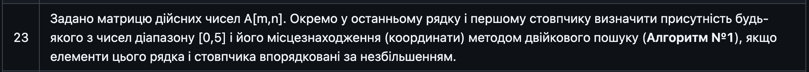
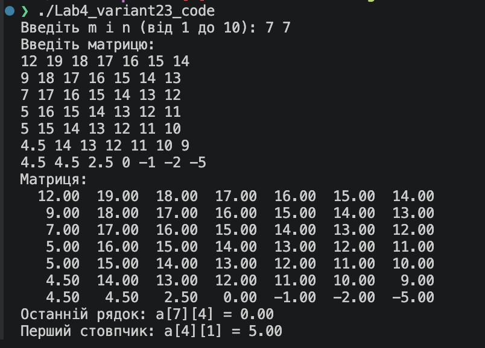
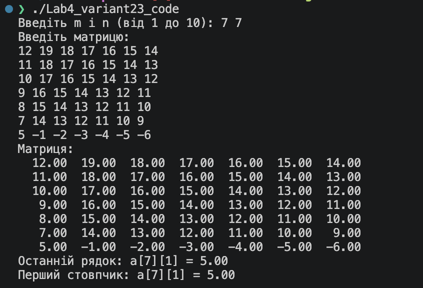
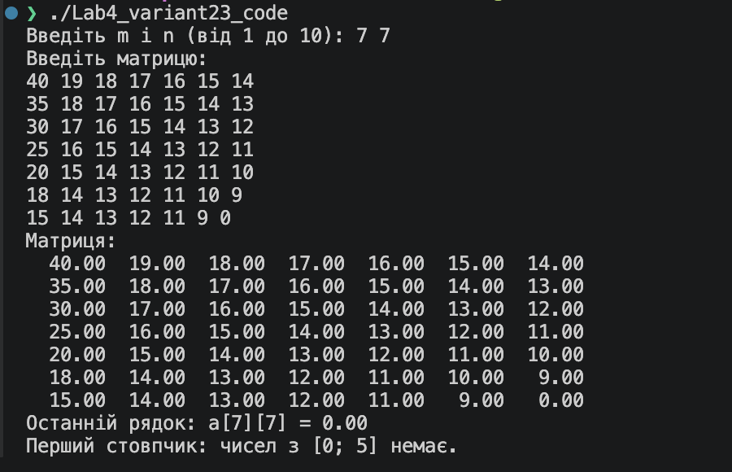
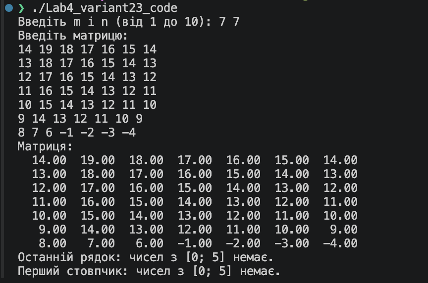
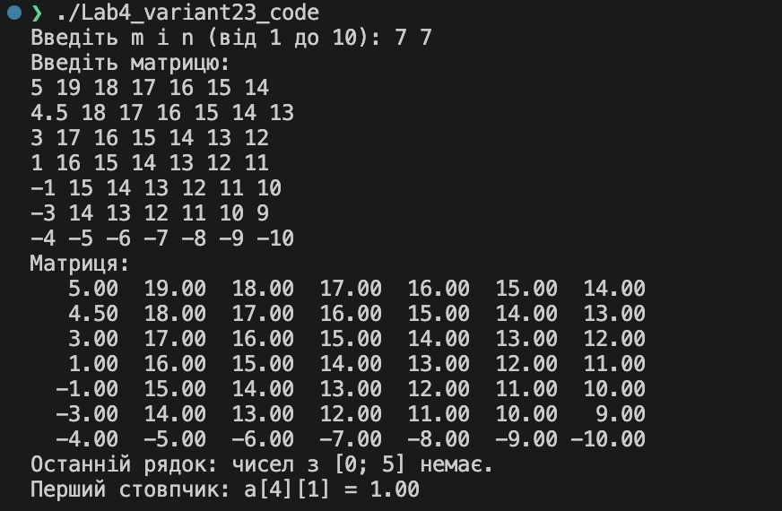
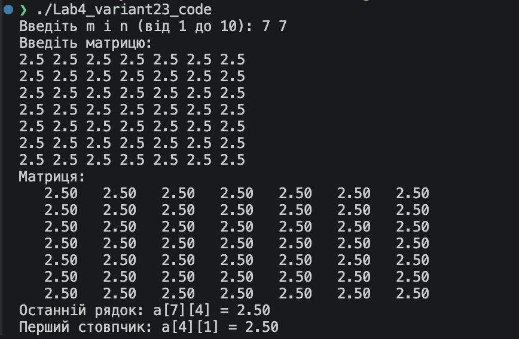

# Лабораторна робота №4

**Міністерство освіти і науки України**  
**Заклад освіти:** Національний технічний університет України «Київський політехнічний інститут ім. І. Сікорського»  
**Факультет:** Факультет інформатики та обчислювальної техніки  
**Кафедра:** Кафедра обчислювальної техніки  
**Дисципліна:** Структура даних і алгоритми  
**Виконав:** Степанов А. О., студент групи ІО-62  
**Номер у списку групи:** 23  
**Перевірив:** Русінов В. В.  
**Київ — 2026**

## Мета

Засвоєння теоретичного матеріалу та набуття практичних навичок розв'язання задачі пошуку заданої категорії елементів за допомогою різних алгоритмів методу двійкового пошуку у двовимірних масивах.

## Завдання

1. Написати програму розв'язання задачі пошуку (за варіантом) у двовимірному масиві (матриці) методом двійкового пошуку. Конкретний алгоритм двійкового пошуку (№1 або №2) задається варіантом завдання.
2. Розміри матриці `m` та `n` взяти самостійно в межах від 7 до 10.
3. При тестуванні програми підбирати такі вхідні набори значень матриці, щоб можна було легко відстежити коректність виконання пошуку, і щоб ця коректність була протестована для всіх можливих випадків. З метою тестування дозволяється використовувати матриці меншого розміру.

## Варіант 23



## Алгоритм

1. Ввести та вивести матрицю. В останньому рядку порівнювати середній елемент з межами діапазону: для значення понад 5 шукати праворуч, для значення нижче 0 — ліворуч. При збігу зупинитися.
2. Так само перевірити перший стовпчик. Для кожного пошуку вивести координати й значення або повідомлення про відсутність збігу.

## Код програми

Файл: [`Lab4_variant23_code.c`](Lab4_variant23_code.c)

```c
#include <math.h>
#include <stdio.h>

int main(void)
{
    double a[10][10];
    int m, n, i, j, left, right, middle;

    printf("Введіть m і n (від 1 до 10): ");
    int read = scanf("%d%d", &m, &n);
    if (read != 2) {
        printf("Введіть два цілі числа.\n");
        return 1;
    }
    if (m < 1 || m > 10 || n < 1 || n > 10) {
        printf("Неправильні розміри.\n");
        return 1;
    }

    printf("Введіть матрицю:\n");
    for (i = 0; i < m; i++) {
        for (j = 0; j < n; j++) {
            read = scanf("%lf", &a[i][j]);
            if (read != 1) {
                printf("Некоректне число в матриці.\n");
                    return 1;
            }
            if (isfinite(a[i][j]) == 0) {
                printf("Введіть скінченне число.\n");
                return 1;
            }
        }
    }

    for (j = 1; j < n; j++) {
        if (a[m - 1][j] > a[m - 1][j - 1]) {
            printf("Останній рядок має бути незростаючим.\n");
            return 1;
        }
    }
    for (i = 1; i < m; i++) {
        if (a[i][0] > a[i - 1][0]) {
            printf("Перший стовпчик має бути незростаючим.\n");
            return 1;
        }
    }

    printf("Матриця:\n");
    for (i = 0; i < m; i++) {
        for (j = 0; j < n; j++)
            printf("%7.2f", a[i][j]);
        printf("\n");
    }

    left = 0;
    right = n - 1;
    while (left <= right) {
        middle = (left + right) / 2;
        if (a[m - 1][middle] > 5)
            left = middle + 1;
        else if (a[m - 1][middle] < 0)
            right = middle - 1;
        else
            break;
    }
    if (left <= right)
        printf("Останній рядок: a[%d][%d] = %.2f\n",
            m, middle + 1, a[m - 1][middle]);
    else
        printf("Останній рядок: чисел з [0; 5] немає.\n");
    left = 0;
    right = m - 1;
    while (left <= right) {
        middle = (left + right) / 2;
        if (a[middle][0] > 5)
            left = middle + 1;
        else if (a[middle][0] < 0)
            right = middle - 1;
        else
            break;
    }
    if (left <= right)
        printf("Перший стовпчик: a[%d][1] = %.2f\n",
            middle + 1, a[middle][0]);
    else
        printf("Перший стовпчик: чисел з [0; 5] немає.\n");
    return 0;
}
```

## Результати перевірки

| Приклад | Останній рядок | Перший стовпчик |
| --- | --- | --- |
| Середина | (7; 4), 0.00 | (4; 1), 5.00 |
| Ліва межа рядка | (7; 1), 5.00 | (7; 1), 5.00 |
| Права межа рядка | (7; 7), 0.00 | немає |
| Без збігів | немає | немає |
| Лише стовпчик | немає | (4; 1), 1.00 |
| Однакові 2.5 | (7; 4), 2.50 | (4; 1), 2.50 |

У таблиці наведено координати та знайдене значення. Перевірка простим переглядом рядка і стовпчика дала ті самі висновки про наявність числа з `[0; 5]`. При повтореннях алгоритм №1 знаходить довільний збіг, тому не зобов’язаний повертати першу позицію. Одна ітерація відкидає приблизно половину поточного проміжку. Сумарна складність двох пошуків — `O(log n + log m)`, без урахування введення та друку всієї матриці.

## Кроки пошуку

| Приклад | Останній рядок | Перший стовпчик |
| --- | --- | --- |
| Середина | 1 / 3 / 1 | 1 / 3 / 4 |
| Ліва межа рядка | 3 / 3 / 1 | 3 / 3 / 7 |
| Права межа рядка | 3 / 3 / 7 | 3 / 3 / 7 |
| Без збігів | 3 / 3 / 7 | 3 / 3 / 7 |
| Лише стовпчик | 3 / 3 / 7 | 1 / 3 / 1 |
| Однакові 2.5 | 1 / 3 / 1 | 1 / 3 / 1 |

Числа в кожній клітинці відповідають алгоритму №1, алгоритму №2 і лінійному перегляду. Один крок — перегляд одного елемента. Алгоритми порівняно в окремій перевірці на тих самих матрицях.

На матриці з однаковими `2.5` алгоритм №1 повернув `(7; 4)` та `(4; 1)`. Алгоритм №2 і лінійний перегляд знайшли перші збіги `(7; 1)` та `(1; 1)`.

## Скріншоти виконання програми

### Середина



### Ліва межа рядка



### Права межа рядка



### Без збігів



### Лише стовпчик



### Однакові 2.5



## Висновок

Пошук правильно працює для збігів усередині та на межах рядка і стовпчика, а також за їх відсутності. Перевірено дробові значення й повторення. Останній рядок та перший стовпчик перевіряються окремо; пошук завершується відразу після знаходження будь-якого числа з `[0; 5]`.
